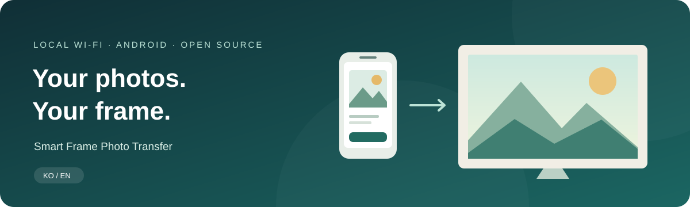
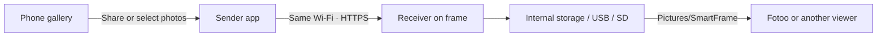

<h1 align="center">Smart Frame Photo Transfer</h1>

Pick on your phone. Send to your frame. Enjoy with Fotoo.

<a href="README.md">한국어</a> · <b>English</b>

<a href="https://github.com/Jungsik-won/smart-frame-photo-transfer/releases">Download APKs</a> · <a href="docs/GUIDE.en.md">Setup & user guide</a> · <a href="docs/BUILD.md">Build from source</a> · <a href="https://github.com/Jungsik-won/smart-frame-photo-transfer/issues">Report an issue</a>

---

**Two small Android apps that send photos from a phone to an Android photo frame on the same Wi-Fi network.** Install the **sender** on your phone and the **receiver** on your frame. A separate viewer, such as Fotoo, displays the saved photos. This project's photo transfer does not require a cloud account or subscription.

Built to make a Lenovo Smart Frame easier for family members to use with local photos. This is an independent project, not an official Lenovo or Fotoo product.

> **Early public release · experimental**
> Sender **0.5.0** / receiver **0.1.5**. The app interface is currently **Korean**; documentation is available in Korean and English.
> Connectivity has been confirmed on a Lenovo frame. Recent sharing, external-storage, and deletion features still need device validation. See [testing status](docs/TESTING.md).

## ✨ How it works

| On your phone | On your frame |
| --- | --- |
| Tap to select multiple photos | Pair phones with a connection code |
| Send from Android's **Share** menu | Choose internal, USB, or SD storage |
| Large controls and a simple home screen | Create the destination folder on the first upload |
| Duplicate checks, retries, and transfer history | Pair multiple phones; start receiving service after reboot |
| Select and delete photos from the frame | Register received images with MediaStore |

**Your phone's originals are never deleted by the frame-deletion feature.** It only manages photos transferred by this app to the receiver's currently selected storage.

## 📥 Downloads

| Install on | APK | Minimum OS |
| --- | --- | --- |
| Android phone | `smart-frame-sender-0.5.0.apk` | Android 8.0 |
| Android frame | `smart-frame-receiver-0.1.5.apk` | Android 10 |

**[Get APKs from Releases →](https://github.com/Jungsik-won/smart-frame-photo-transfer/releases)**

Release assets include `SHA256SUMS.txt`. To update, install a newer APK signed by the same publisher over the existing app; do not uninstall first. Android may show installation-permission or scanning prompts.

## 🚀 One-time setup

1. **Frame:** install and open the receiver; select the photo storage location.
2. **Phone:** install the sender; open **⚙ 설정 → 액자 연결 · 변경** (Settings → Connect/change frame).
3. Connect both devices to the **same Wi-Fi**. Discover the frame or enter the address displayed by the receiver.
4. Compare the **connection verification text** on both devices, then pair with the frame's **connection code**.
5. Send a few photos. In **Fotoo → Gallery**, select the **SmartFrame** album.

For everyday use: **phone gallery → select photos → Share → 액자에 사진 보내기 → 사진 보내기**. Opening the app through Share does not transmit automatically; check the destination and queued photos before tapping Send.

**[Read the step-by-step guide →](docs/GUIDE.en.md)**

## What to expect

- Photos only. **No video transfer, iPhone app, or remote transfer across the public internet.**
- JPEG, PNG, and WebP are supported. HEIC/HEIF files that the phone can decode are converted to JPEG.
- Limits: **200 queued photos**, **50 MiB per photo**, and approximately **500 MiB** of staged copies on the phone.
- Duplicate checks use SHA-256 file content. Edited or re-encoded versions of the same scene can count as different photos.
- USB/SD must be recognized by Android as writable shared image storage. An unavailable selected volume causes a transfer failure; there is no silent fallback to internal storage.
- Fotoo requires separate installation and setup. Album refresh and display timing depend on its version and settings.
- Boot startup starts the receiver's **background receiving service**. It does not guarantee Fotoo will open or stay above Lenovo's default home app.
- Normal installation needs no USB debugging, device-owner enrollment, or root. You must already be able to install APKs and access the required Android settings.
- **This repository does not bypass Lenovo activation after a factory reset, disable the official app, or schedule device reboots.**

## 🔒 Photos and pairing

Photos travel directly over the local network. Users compare verification text for the receiver's self-signed certificate before pinning it; paired phones authenticate using tokens. There is no feature that uploads your photos to an internet server.

The receiver and viewer are separate applications. Consult Fotoo or your chosen viewer for its own network behavior and privacy policy. This project has not undergone an independent security audit.

## 🛠 Development

Native Java, built with PowerShell, JDK 17, and Android SDK tools, without Gradle.

| Document | Contents |
| --- | --- |
| [English guide](docs/GUIDE.en.md) / [한국어 설명서](docs/GUIDE.ko.md) | Setup, sharing, storage, deletion, troubleshooting |
| [Build guide](docs/BUILD.md) | Toolchain, signing, and tests |
| [Testing status](docs/TESTING.md) | Automated checks versus device validation |
| [Changelog](CHANGELOG.md) | Sender and receiver version history |
| [Contributing](CONTRIBUTING.md) | Bug reports and patches |

## License and affiliation

Original project code and documentation are provided under the [MIT License](LICENSE). Third-party applications, firmware, SDKs, private signing keys, and device backups are not included. All third-party trademarks and software remain the property of their respective owners.
