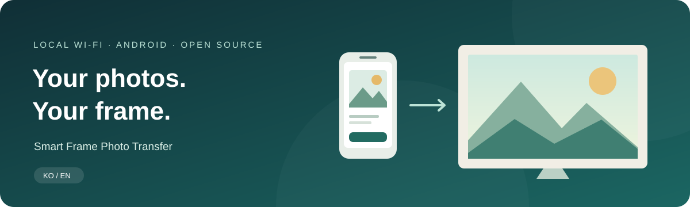
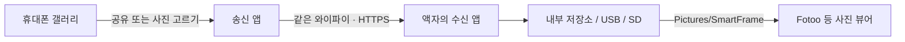

<h1 align="center">스마트 액자에 사진 보내기</h1>

갤러리에서 고르고, 액자로 보내고, Fotoo로 감상하세요.

<b>한국어</b> · <a href="README.en.md">English</a>

<a href="https://github.com/Jungsik-won/smart-frame-photo-transfer/releases">APK 다운로드</a> · <a href="docs/GUIDE.ko.md">설치·사용 설명서</a> · <a href="docs/BUILD.md">직접 빌드</a> · <a href="https://github.com/Jungsik-won/smart-frame-photo-transfer/issues">문제 제보</a>

---

**안드로이드 휴대폰의 사진을 같은 와이파이에 있는 안드로이드 액자로 전송하는 작은 앱 두 개입니다.**
휴대폰에는 **송신 앱**, 액자에는 **수신 앱**을 설치합니다. 수신 앱이 저장한 사진은 Fotoo 같은 별도 뷰어로 표시합니다. 이 프로젝트의 사진 전송에는 클라우드 계정이나 구독이 필요하지 않습니다.

Lenovo Smart Frame을 가족이 쓰기 쉬운 로컬 사진 액자로 활용하려고 만들었습니다. Lenovo 또는 Fotoo의 공식 프로젝트가 아닙니다.

> **초기 공개 · 실험적 버전**
> 송신 **0.5.0** / 수신 **0.1.5**. 앱 화면은 현재 **한국어**이며, 문서는 한국어와 영어로 제공합니다.
> Lenovo 프레임의 연결 성공은 확인했지만 최신 공유·외부 저장소·삭제 기능의 실기 검증은 진행 중입니다. [검증 범위](docs/TESTING.md)를 확인하세요.

## ✨ 이렇게 씁니다

| 휴대폰에서 | 액자에서 |
| --- | --- |
| 사진을 톡톡 눌러 여러 장 선택 | 연결번호로 휴대폰 등록 |
| 갤러리의 **공유 → 액자에 사진 보내기** | 내부 저장소·USB·SD 중 저장 위치 선택 |
| 큰 버튼과 간단한 첫 화면 | 첫 사진을 받을 때 폴더 자동 생성 |
| 중복 확인, 실패한 사진 재시도, 전송 기록 | 여러 휴대폰 연결, 재부팅 후 수신 서비스 시작 |
| 액자에 보낸 사진만 골라 삭제 | MediaStore에 사진 등록하여 뷰어에서 접근 |

**휴대폰 원본은 삭제하지 않습니다.** 액자 사진 삭제는 이 앱으로 전송한 사진 중 현재 선택한 저장소의 사진에만 적용됩니다.

## 📥 설치 파일

| 설치할 곳 | APK | 요구 버전 |
| --- | --- | --- |
| 안드로이드 휴대폰 | `smart-frame-sender-0.5.0.apk` | Android 8.0 이상 |
| 안드로이드 액자 | `smart-frame-receiver-0.1.5.apk` | Android 10 이상 |

**[릴리스에서 APK 받기 →](https://github.com/Jungsik-won/smart-frame-photo-transfer/releases)**

릴리스의 `SHA256SUMS.txt`로 파일 해시를 확인할 수 있습니다. 이미 사용 중이면 삭제하지 말고 같은 서명으로 제공된 새 APK를 덮어 설치하세요. Android의 설치 허용·검사 안내가 표시될 수 있습니다.

## 🚀 처음 한 번만

1. **액자:** 수신 앱을 설치해 열고, 사진을 저장할 위치를 선택합니다.
2. **휴대폰:** 송신 앱을 설치하고 **⚙ 설정 → 액자 연결 · 변경**을 엽니다.
3. 두 기기를 **같은 와이파이**에 연결합니다. 액자를 검색하거나 수신 앱에 표시된 주소를 입력합니다.
4. 양쪽 **연결 확인문구**를 비교하고, 액자의 **연결번호**로 등록합니다.
5. 사진을 몇 장 보내고 **Fotoo → Gallery**에서 **SmartFrame** 앨범을 선택합니다.

이후에는 **휴대폰 갤러리 → 사진 선택 → 공유 → 액자에 사진 보내기 → 사진 보내기**로 이용할 수 있습니다. 공유로 앱을 열기만 해서는 전송되지 않으며, 받을 액자와 대기 목록을 확인한 뒤 보내세요.

**[큰 단계별 설치·사용 설명서 읽기 →](docs/GUIDE.ko.md)**

## 알아두면 좋아요

- 사진 전송용 앱입니다. **동영상 전송, iPhone, 외부 인터넷을 통한 원격 전송은 지원하지 않습니다.**
- JPEG·PNG·WebP를 지원하며, 휴대폰이 읽을 수 있는 HEIC/HEIF는 JPEG로 변환합니다.
- 대기 목록 최대 **200장**, 사진당 **50 MiB**, 휴대폰의 대기 복사본 합계 약 **500 MiB** 제한이 있습니다.
- 중복은 파일 내용의 SHA-256으로 확인합니다. 같은 장면이라도 편집·재인코딩된 파일은 다른 사진일 수 있습니다.
- USB/SD는 Android가 쓰기 가능한 공유 사진 저장소로 인식해야 합니다. 분리되면 전송을 실패 처리하며 내부 저장소로 자동 전환하지 않습니다.
- Fotoo는 별도 설치·설정이 필요합니다. 앨범 갱신 및 표시 시점은 Fotoo 버전과 설정에 따라 달라집니다.
- 수신 앱의 부팅 후 실행은 **사진을 받는 서비스**를 시작하는 기능입니다. Fotoo 자동 표시나 Lenovo 기본 홈 앱보다 먼저 뜨는 것을 보장하지 않습니다.
- 일반 설치에 USB 디버깅·기기 관리자·루트는 필요하지 않습니다. 다만 기존 기기에서 APK 설치와 Android 설정 접근이 가능해야 합니다.
- **공장 초기화 후 Lenovo 활성화를 우회하거나, 공식 앱을 비활성화하거나, 기기를 예약 재부팅하는 도구는 포함하지 않습니다.**

## 🔒 사진과 연결

사진은 휴대폰과 액자 사이의 로컬 네트워크로 전송합니다. 자체 서명 인증서의 확인문구를 사용자가 비교한 뒤 인증서를 고정하며, 등록된 휴대폰의 토큰으로 접근합니다. 인터넷 서버로 사진을 업로드하는 기능은 없습니다.

수신 앱과 뷰어는 별개입니다. Fotoo 등 다른 앱의 네트워크 동작과 개인정보 정책은 해당 앱의 안내를 확인하세요. 이 프로젝트는 독립적인 보안 감사를 받은 제품이 아닙니다.

## 🛠 개발 및 참여

네이티브 Java 앱이며 Gradle 없이 PowerShell, JDK 17, Android SDK 도구로 빌드합니다.

| 문서 | 내용 |
| --- | --- |
| [한국어 사용 설명서](docs/GUIDE.ko.md) / [English guide](docs/GUIDE.en.md) | 설치, 공유, 저장소, 삭제, 문제 해결 |
| [빌드 안내 / Build](docs/BUILD.md) | 개발 환경, 서명, 테스트 |
| [검증 현황 / Testing](docs/TESTING.md) | 자동 검사와 실제 기기 검증의 범위 |
| [변경 기록 / Changelog](CHANGELOG.md) | 송신·수신 앱 버전별 변경 사항 |
| [기여 안내 / Contributing](CONTRIBUTING.md) | 버그 제보와 수정 제안 |

## 라이선스 및 관계

직접 작성한 코드와 문서는 [MIT 라이선스](LICENSE)로 배포합니다. Lenovo·Fotoo 등 타사 앱, 펌웨어, SDK, 서명 키와 기기 백업은 포함하지 않습니다. 상표와 타사 소프트웨어의 권리는 각 소유자에게 있습니다.
